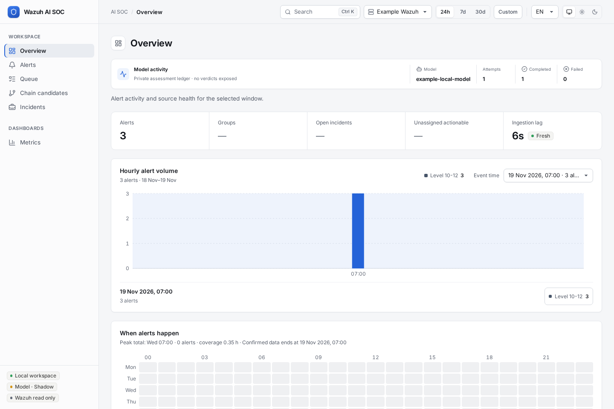
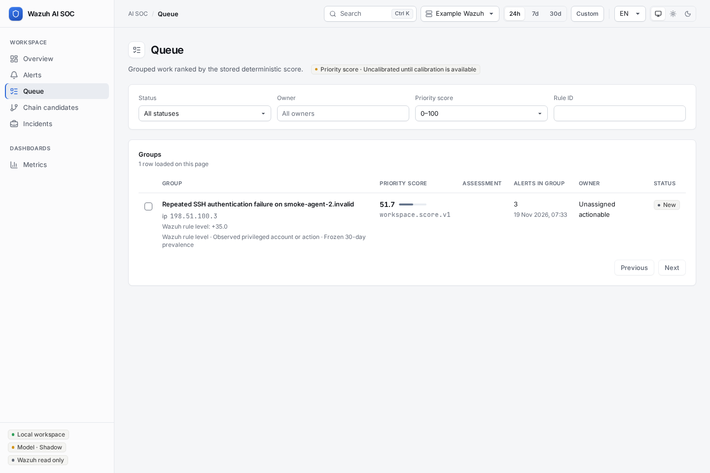
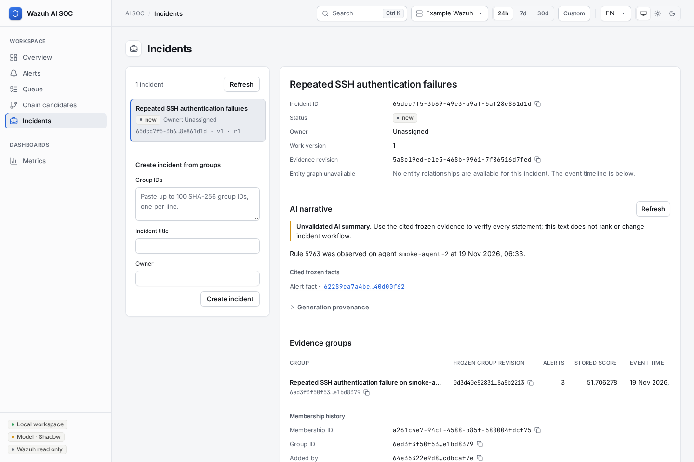

# Wazuh AI SOC

Wazuh AI SOC is a self-hosted analyst workspace. It reads alerts from your Wazuh Indexer, groups and ranks them, and gives analysts a place to investigate and track the results. An optional local or hosted OpenAI-compatible model can assess selected alert groups in shadow mode.

## Console preview

These screenshots show the running local workspace with invented Wazuh alerts.



### Alert queue



### Incident detail



## Run your own local instance

From the repository's `ai-soc` directory on Linux, install the prerequisites and create your private configuration. [Local deployment guide](docs/local-deployment.md)

```sh
make local-init
```

Set your Indexer URL, trusted CA, and dedicated read-only credentials in the initialized state directory. Add an assessment model if you want one. Then start the workspace.

```sh
make local
```

Open the loopback URL printed by the launcher and sign in with the key file it creates for that run. PostgreSQL keeps your alerts and analyst work between restarts. Stop the instance with Ctrl+C or `make local-down`.

## Run the AWS Investigate service from source

From the `ai-soc` directory on Linux, install Python 3.12.13, uv, GNU Make, Node.js 22.23.3, and npm. Install Docker Engine with Compose v2 if you use the workspace PostgreSQL container.

```sh
uv sync --locked --no-dev
npm --prefix web ci --include=dev --no-audit --no-fund
npm --prefix web run build
```

The browser assets are in `web/dist`. For the PostgreSQL setup, read-only Wazuh source configuration, and workers, follow [Workspace operations](docs/operations/workspace.md).

The live Investigate service requires a sealed service configuration, reviewed content pack, AWS service roles, and the trusted ALB/OIDC integration. Set `SOC_SERVICE_CONFIG_PATH` and `SOC_WEB_DIST` to the sealed document and the absolute browser build path. Start the service behind the trusted proxy.

```sh
uv run --locked --no-dev uvicorn ai_soc.live.entrypoint:create_app --factory --host 127.0.0.1 --port 8000
```

The live entry point currently mounts the Investigate API. The workspace runbook covers the database, ingestion, and workers.

## How Investigate works

1. Routing cues map the question to reviewed topics. Questions that match no topic get a clarification or a refusal, never a guess.
2. Each topic runs a read-only playbook: allowlisted indexer queries, count and field checks, and recency checks, under the analyst's own indexer permissions.
3. The model selects findings only from reviewed templates, and every finding must cite evidence returned in step 2. An independent validator removes anything uncited or unsupported.
4. Every answer is audited to an encrypted queue before it is returned. If audit is unavailable, no answer is returned.

See [Architecture](docs/architecture.md) for the full request flow and how false positives and false all-clears are handled.

## Repository layout

| Path | Contents |
|---|---|
| `src/ai_soc` | Service: API, MCP, planning, query, judgment, validation, state, telemetry |
| `web/` | Browser UI (React and TypeScript, built into the image) |
| `contracts/v1` | Generated wire schema, OpenAPI document and TypeScript types |
| `infra/` | Terraform for the AWS deployment, plus the reference egress proxy |
| `scripts/` | Image build, platform preparation, live qualification and teardown checks |
| `examples/content-seed` | A runnable synthetic content repository: topics, playbooks, templates, public docs |
| `config/` | Example service configuration and qualification IAM policies |
| `docs/` | Architecture, specification, contracts, source capabilities and runbooks |

## Developer setup

For the basic checks, install Git, GNU Make, CPython 3.12.13, [uv 0.11.28](https://docs.astral.sh/uv/), and Node.js 22.23.3 with npm. Dependency installation needs network access.

```sh
make dev-setup
cd web
PLAYWRIGHT_BROWSERS_PATH="$PWD/../build/tool-cache/playwright" npx playwright install --with-deps chromium
cd ..
make ci-check
```

On systems where Playwright's `--with-deps` cannot install OS packages, install the documented Chromium dependencies for your platform first, then run the same command without `--with-deps`. `make test` runs the public synthetic Python contract checks. `make test-web` runs the web unit checks. `make ci-check` also runs Python lint, formatting and type checks, web contract and type checks, browser and CSP tests, and the live web build. The browser tests use synthetic mocked API responses and do not qualify a deployed service. The private historical test corpus is not part of the public checkout. The production index check runs when a Git worktree is available; a source archive without Git skips that check.

The [CI workflow](../.github/workflows/ai-soc-ci.yml) runs `make ci-check` on pull requests and pushes to `main` that touch `ai-soc/`. To run the same check before each local commit, install the opt-in hook with `python3 scripts/agent_checks.py install`.

## Image and deployment prerequisites

The image and infrastructure workflows are separate from the basic developer setup. They require Linux x86_64, Docker Engine with BuildKit, bubblewrap at `/usr/bin/bwrap` with user and network namespaces, `gcc`, `curl`, `unzip`, `tar`, `xz`, and `sha256sum`. Image builds need at least 2 GiB free on `/dev/shm`.

`make bootstrap` prepares their pinned tools, browser runner, and container caches. It downloads dependencies and images, and requires the local container infrastructure. The subsequent offline image and infrastructure commands use those caches. These workflows are not included in `make ci-check`.

Deployment also requires an AWS account with an existing VPC and private subnets, an ACM certificate, an OIDC identity provider, Bedrock model and guardrail access, and private network reachability to the Wazuh indexer.

## Build the content pack

Topics, routing cues, playbooks, finding templates and public reference pages live in a separate content repository, built and signed with the `ai-soc-content` CLI. `examples/content-seed` is a complete synthetic example; copy it into its own Git repository and replace its content with reviewed content for your site. Its [README](examples/content-seed/README.md) walks through building and verifying a pack.

The playbook limits in the seed (for example the one-hour recency limit) are synthetic. Set real values from your site's ingestion behavior. [Source capabilities](docs/source-capabilities.md) lists what each Wazuh source can and cannot establish.

## Build the service image

To validate the browser application separately, run these commands from `web/`:

```sh
npm ci
npm run typecheck
npm run validators:check
npm run workspace-types:check
npm run workspace-validators:check
npm test
npm run build
```

The build writes the static application to `web/dist/`. The type and validator checks compare generated files with the service contracts. The browser tests use the Chromium installed in the developer setup and synthetic mocked API responses; they do not qualify the deployed service.

Run `npm run dev` from `web/` to start the Vite development server. Run `npm run preview` to serve the built files. Both commands use live APIs and provide no authentication or API proxy. Supply an authenticated, same-origin `/v1` integration before you use the browser application with a service.

```sh
make image-reproducibility
```

This builds `web/`, then makes clean linux/amd64 OCI builds with `--network=none` and `--no-cache`, and checks that two independent builds of the same commit produce identical config and layer digests. The generated files are copied into `/service/web/dist` inside the image so the existing service mount remains stable. The content pack is a provenance input recorded in image labels, not baked into the image. Evidence and the OCI archives are written under `build/evidence/image-repro/`. Push the verified image to a private ECR repository and deploy it by digest.

## Deploy on AWS

Follow [infra/README.md](infra/README.md). In short:

1. Configure an encrypted remote Terraform state backend outside git, and keep `*.tfvars` outside git.
2. Supply the VPC, subnets, certificate, OIDC settings, indexer CIDRs and CA, Bedrock model and guardrail ARNs, image digest, content commit and alarm topic.
3. Validate offline with `make infra-check`, then plan and apply from your protected deployment system.
4. Probe Bedrock capability with the [model probe runbook](docs/operations/model-probe.md) before enabling a model.

The module creates no VPC, public subnet or NAT gateway. Session resources (ALB, tasks, endpoints) can be switched off between use windows while keys, state, audit storage and alarms remain; `make check-session-teardown` verifies the result.

## Qualify the deployment

Offline checks do not prove a live site works. Before analysts rely on the service, run the live validation gates in the [continuity runbook](docs/operations/continuity.md): source mapping and field coverage, analyst document-level permissions, count and paging behavior, model and guardrail responses, budgets, and audit queue and archive recovery. `make staging-golden` runs the synthetic staging evaluation from the protected environment; `examples/staging-validation.manifest.example.json` shows the manifest shape. Any gate that cannot run stays `NOT_RUN` or `NOT_CONFIGURED` rather than passing.

## Operations

- [Disaster recovery and live validation runbook](docs/operations/continuity.md)
- [Telemetry and audit operations](docs/operations/telemetry.md)
- [Bedrock capability probe](docs/operations/model-probe.md)

## Reference

- [Architecture](docs/architecture.md)
- [Domain glossary](CONTEXT.md)
- [Service specification](docs/specification.md)
- [Service and wire contracts](docs/contracts.md)
- [Source capabilities](docs/source-capabilities.md)

## Security

To report a vulnerability, follow the process in [SECURITY.md](SECURITY.md). Do not open public issues for security problems.

## Disclaimer

This software is provided "AS IS", without warranty of any kind. The author and contributors accept no liability for damages, data loss, missed detections, false positives, security incidents, or costs (including LLM and cloud costs). Use is at your own risk. Every AI-generated output must be reviewed by a human before you act on it. This project is not affiliated with or endorsed by Wazuh Inc. or any LLM provider.

## License

MIT. See [LICENSE](LICENSE).
